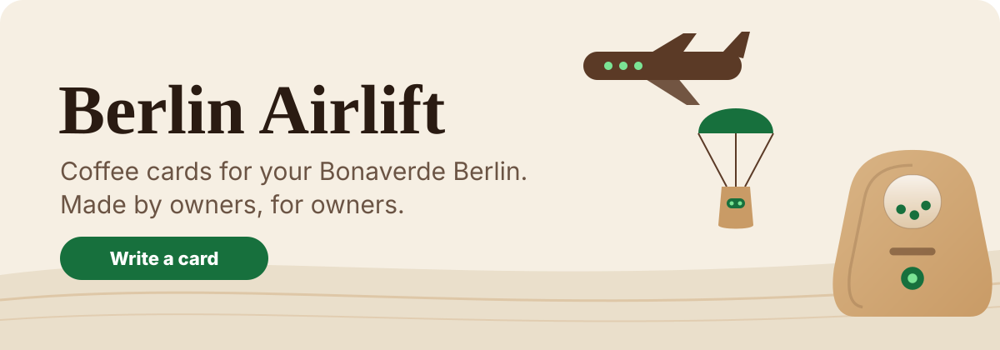
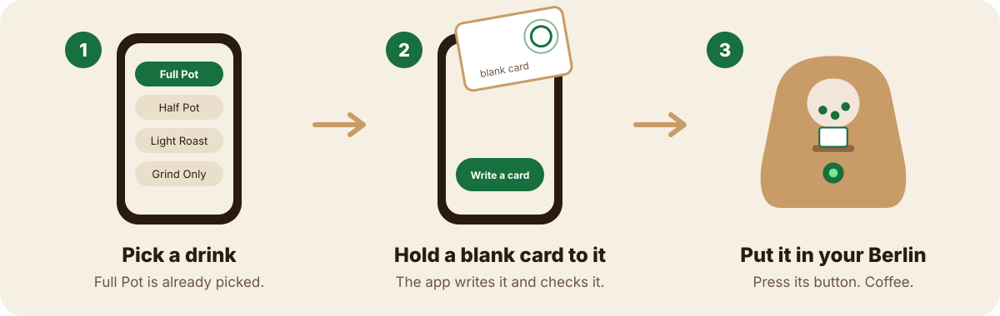
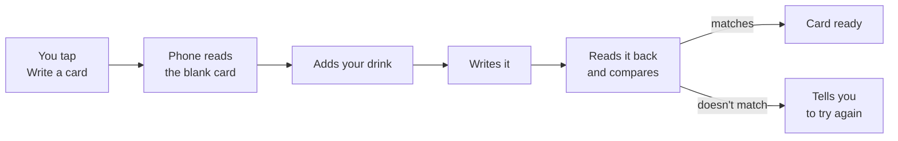
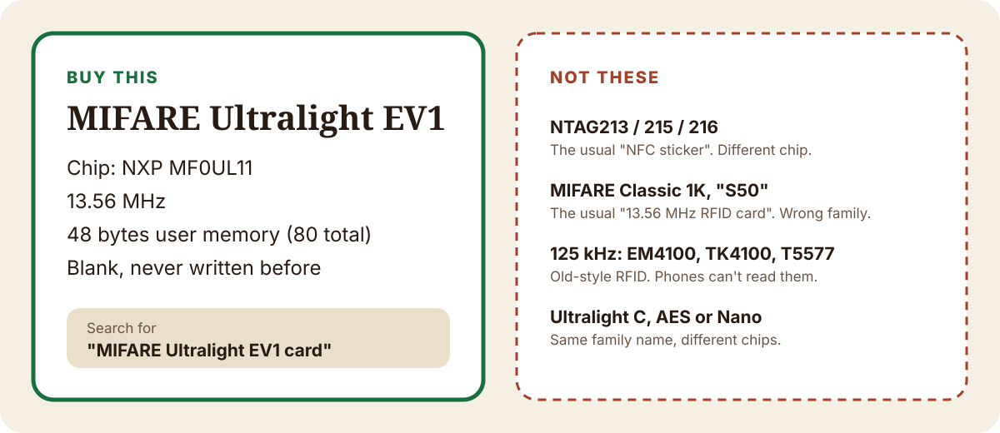

<p align="center"></p>

# Berlin Airlift

**A free phone app that writes the coffee cards your Bonaverde Berlin needs, so it keeps roasting, grinding and brewing.**

Made by owners, for owners. No account, no ads, no tracking. Open source.

> Berlin Airlift is an independent community project. It is not made, endorsed or supported by Bonaverde or by the owners of the Bonaverde and Berlin trademarks. Bonaverde and Berlin are trademarks of their respective owners and are named here only to say which machine the app works with.

---

## Who this is for

You own a **Bonaverde Berlin**: the coffee machine that takes green coffee beans and roasts, grinds and brews them in one go. It only starts when you put a small card in it, and the company that sold those cards is gone.

If your Berlin is sitting in a cupboard because you ran out of cards, this app is for you. You don't need to know anything about NFC, chips or code. If you can use a phone, you can use this.

## Why it exists

The Berlin does something almost no home machine does. Coffee leaves the farm as green beans, and the Berlin roasts them minutes before it brews. That is about as fresh as coffee gets. We love that, and we love the growers behind it, especially the small co-ops in places like Guatemala who do the hardest part of the work.

Every brew starts with a card that tells the machine what to do. Bonaverde raised over $680,000 from more than 2,200 Kickstarter backers in 2013, shipped the Berlin, and filed for insolvency in October 2019. ([sources](docs/STORY.md#sources))

A well-made machine that needs one company's cards is only as long-lived as that company. Owners worked out the card format years ago. Berlin Airlift puts that work into one friendly button. The longer story is in [docs/STORY.md](docs/STORY.md).

## How it works

<p align="center"></p>

1. **Pick a drink.** Full Pot is already picked, so most days you skip this.
2. **Tap Write a card and hold a blank card to your phone.** iPhone: the top of the back. Android: usually the middle of the back. Keep it still until the phone buzzes.
3. **Put the card in your Berlin and press its button.** Coffee.

Every card is checked before the app says it's ready. If anything went wrong, it tells you in plain words.



### What you can make

| Drink | What it does |
|---|---|
| **Full Pot** | Green beans in, about 900 ml of coffee out |
| **Half Pot** | Smaller batch, about 600 ml |
| **Overnight** | Roasts tonight, brews 10 hours later |
| **Light, Medium, Dark Roast** | Roasts only, so you can grind and brew later |
| **Grind and Brew** | For beans that are already roasted |
| **Grind Only, Hot Brew, Gentle Brew** | One step at a time |
| **Care cards** | Descale, clean the grinder, reset the air filter count |

You can also set a wait between roasting and brewing, from 1 minute to 24 hours, and check or copy any card you already have with **What's on this card?**

## Which card to buy

This is the part people get wrong, so here it is plainly.

<p align="center"></p>

**Buy blank MIFARE Ultralight EV1 cards.** The exact chip is the NXP **MF0UL11**.

- **Search for:** `MIFARE Ultralight EV1 card`, `Ultralight EV1 NFC card 13.56MHz` or `MF0UL11`.
- **Check the listing says:** MIFARE Ultralight EV1 (made by NXP), 13.56 MHz, 48 bytes of memory (80 bytes total).
- **Be wary of** listings that only say "NFC card", "NFC sticker" or "RFID card". Those are usually NTAG213 stickers or MIFARE Classic cards, which is not what the Berlin uses.

| Looks right, but isn't | Why |
|---|---|
| NTAG213, NTAG215, NTAG216 | The usual "NFC card" or sticker. A different chip, not proven on the Berlin. |
| MIFARE Classic 1K, "S50", "Fudan F08" | The usual "13.56 MHz RFID card". A different family. |
| 125 kHz cards: EM4100, TK4100, T5577, "proximity" | Old-style RFID. Phones can't read them at all. |
| Ultralight C, Ultralight AES, Ultralight Nano | Same family name, different chips. |
| Ultralight EV1 with 128 bytes (MF0UL21) | The bigger EV1. Its settings live in a different place on the chip. Untested. |

Not sure about a card you already have? Hold it to your phone in **What's on this card?** It shows whether the card already holds a drink your machine will take. It can't yet tell an empty NTAG sticker from an empty EV1 card, so buy by the chip name. More detail and sources: [docs/CARDS.md](docs/CARDS.md).

## What you need

- A Bonaverde Berlin
- Blank MIFARE Ultralight EV1 cards (see above)
- An iPhone or Android phone with NFC (most phones from the last several years have it)
- Green coffee from any grower you like

## Get the app

Berlin Airlift is not in the App Store or Google Play yet. It is being tested on real machines first. Watch this repository for the release.

## Questions

**Can I reuse a card?** Yes, and that's the default. One card can be your daily Full Pot. You can switch to single-use cards, like the originals, in **More**.

**My card didn't work.** Hold it flat and still until the phone buzzes. If it still fails, try a new blank card: some cards get locked and can never be written again.

**Is this safe for my machine?** The app writes the same card format owners have used for years, and it checks each card before saying it's ready. Roasting makes heat and smoke, so use your Berlin the way its manual says and keep the air filter fresh.

**Is my data private?** Yes. No account, no ads, no tracking, and the app makes no network calls. See [PRIVACY.md](PRIVACY.md).

**Is this made by Bonaverde?** No. It's an independent community project. More answers in [docs/FAQ.md](docs/FAQ.md).

## Credits

With real thanks to the people whose work this stands on. Full list: [docs/CREDITS.md](docs/CREDITS.md).

- **[VerdeNFC](https://github.com/btrappe/VerdeNFC) by Bernd Trappe** (Apache 2.0): the card checksums and the community card templates this app writes.
- **[hackaverde](https://github.com/PostalBlab/hackaverde) by PostalBlab** and contributors: the card layout and the real card dumps every test checks against.
- **Craig Whyte, Michael Grundler** and the owner groups, for the knowledge that made all of this possible.
- **[raspiverde](https://github.com/MarcusWolschon/raspiverde) by Marcus Wolschon**, for taking the Berlin further on a Raspberry Pi.
- **Bonaverde**, for building a machine good enough that all of us bothered.

---

<details>
<summary><b>For developers</b></summary>

The app is Expo (SDK 58) and React Native, for iOS and Android, in [`app/`](app/).

```bash
cd app
npm ci
npx tsc --noEmit   # typecheck
npx jest           # protocol golden tests and screen tests
npx expo start     # demo mode works in Expo Go and on the web
```

NFC needs a development build (`expo-dev-client`), not Expo Go. Demo mode (a pretend card) is on in development and on the web. Store builds leave it out unless `EXPO_PUBLIC_DEMO=1` is set. CI runs on Codemagic ([`codemagic.yaml`](codemagic.yaml)).

```text
app/src/protocol/    card bytes: checksums, card image, pause scale, 33 community templates, the drink menu
app/src/nfc/         iOS and Android card readers, write with read-back compare, a fake card for demo and tests
app/src/screens/     one home screen and four sheets: drinks, what's on this card, help, more
app/src/content/     help and about text shown in the app
app/src/ui/          tokens, wood grain, hold-to-confirm, the curved-wood machine and the cargo plane
tools/verify_checksums.py   independent Python check against real card dumps
docs/                       story, card guide, protocol, menu, FAQ, design, store listing drafts
```

The checksums are proven against real card dumps published by the hackaverde project twice: in TypeScript (`npx jest`) and in plain Python:

```bash
python3 tools/verify_checksums.py
```

Card format details: [docs/NFC-PROTOCOL.md](docs/NFC-PROTOCOL.md). Contributing: [CONTRIBUTING.md](CONTRIBUTING.md). Agent and tooling notes: [app/AGENTS.md](app/AGENTS.md).

</details>

## License and fine print

Licensed under [Apache 2.0](LICENSE). See [NOTICE](NOTICE), [PRIVACY.md](PRIVACY.md) and [SECURITY.md](SECURITY.md).

Bonaverde and Berlin are trademarks of their respective owners. Berlin Airlift is not affiliated with, endorsed by or sponsored by Bonaverde or its successors. The drawings in this repository are our own.
