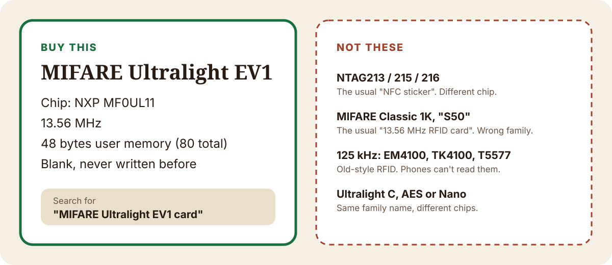

# Which card to buy

The Bonaverde Berlin reads one kind of card: **MIFARE Ultralight EV1**, the small 80-byte version made by NXP, part number **MF0UL11**. Owners worked this out years ago, and every community tool since has written to it ([credits](CREDITS.md)).

Lots of cards look the same in a photo. The chip inside is what matters, and listings often don't say which chip it is. Buying the wrong one is the most common mistake.

## Buy this

| | |
|---|---|
| **Chip** | NXP MIFARE Ultralight EV1, **MF0UL11** |
| **Frequency** | 13.56 MHz (ISO/IEC 14443 Type A) |
| **Memory** | 48 bytes you can write, 80 bytes in total (20 pages of 4 bytes) |
| **State** | Blank, never written or locked |

**Search terms that find it:**

- `MIFARE Ultralight EV1 card`
- `Ultralight EV1 NFC card 13.56MHz`
- `MF0UL11`

**Before you order, check the listing:**

1. It names the chip as **MIFARE Ultralight EV1**. "Compatible" or "works with Ultralight" is not the same thing.
2. It says **13.56 MHz**.
3. It gives the memory as **48 bytes** (or 80 bytes total). If it says 128 bytes, that is the bigger EV1 (MF0UL21), see below.
4. If the listing doesn't name the chip at all, ask the seller or skip it.

We don't link to shops. Sellers change what they ship under the same listing, so the chip name in the listing is the thing to trust.

## Not these

| Card | How it's usually sold | Why it won't do |
|---|---|---|
| **NTAG213, NTAG215, NTAG216** | "NFC card", "NFC sticker", "NFC tag" | The most common NFC chip. A different NXP family, built for general NFC tags. Not proven on the Berlin. |
| **MIFARE Classic 1K** | "13.56 MHz RFID card", "S50", "Fudan F08", hotel or gym key cards | A different family with a different way of storing data. |
| **125 kHz cards** | "RFID proximity card", EM4100, TK4100, T5577 | Older, lower-frequency RFID. Phones cannot read these at all. |
| **MIFARE Ultralight C, Ultralight AES, Ultralight Nano** | Sometimes listed just as "Ultralight" | Same family name, different chips and memory sizes. |
| **MIFARE Ultralight EV1, 128 bytes (MF0UL21)** | "Ultralight EV1 128 byte" | Same family, bigger chip. Its settings sit on different pages (37 to 40 instead of 16 to 19), so it doesn't match what the Berlin expects. Untested. |

## Already have some cards?

Open Berlin Airlift, tap **What's on this card?** and hold the card to your phone.

- **"Your machine will take it"**: it already holds a working drink. You can copy it, or write over it.
- **"Empty and ready to write"**: the phone could read it as an Ultralight-style card. This does not yet prove it is an EV1: an NTAG sticker can read as empty too. Go by the chip name on the packet.
- **"That card won't work"**: the phone couldn't read it the way the Berlin does. MIFARE Classic cards land here. 125 kHz cards don't show up at all.

If a card reads fine but won't take a new drink, it may have been locked by another app. Use a fresh blank.

## Cards or stickers?

Both are sold with the EV1 chip. The Berlin takes a card into a slot, so a credit-card-size card is the simplest. The original Bonaverde cards came attached to bean pouches, so a sticker on stiff card can work too. If you try stickers, check them with **What's on this card?** first.

## Sources

- NXP, *MF0ULX1 MIFARE Ultralight EV1 product data sheet*, Rev. 3.3, 9 April 2019: memory of 640 bits in 20 pages (MF0UL11) and 1312 bits in 41 pages (MF0UL21); configuration pages 10h to 13h (MF0UL11) and 25h to 28h (MF0UL21); ISO/IEC 14443 Type A at 13.56 MHz. https://www.nxp.com/docs/en/data-sheet/MF0ULX1.pdf
- NXP, *MIFARE Ultralight EV1 fact sheet*: 48 and 128 byte user memory variants, compared with Ultralight C and Nano. https://www.nxp.com/docs/en/fact-sheet/MIFARE-ULTRALIGHT-EV1-FS.pdf
- Wakdev, *NXP MIFARE Ultralight EV1*: MF0UL11 (48 bytes) and MF0UL21 (128 bytes); NTAG21x is built for general NFC tags, Ultralight EV1 for ticketing. https://www.wakdev.com/en/knowledge-base/nfc-chips/nxp-mifare-ultralight-ev1.html
- The card format and the "which blanks work" knowledge come from the owner community, VerdeNFC and hackaverde: [CREDITS.md](CREDITS.md), [NFC-PROTOCOL.md](NFC-PROTOCOL.md).
